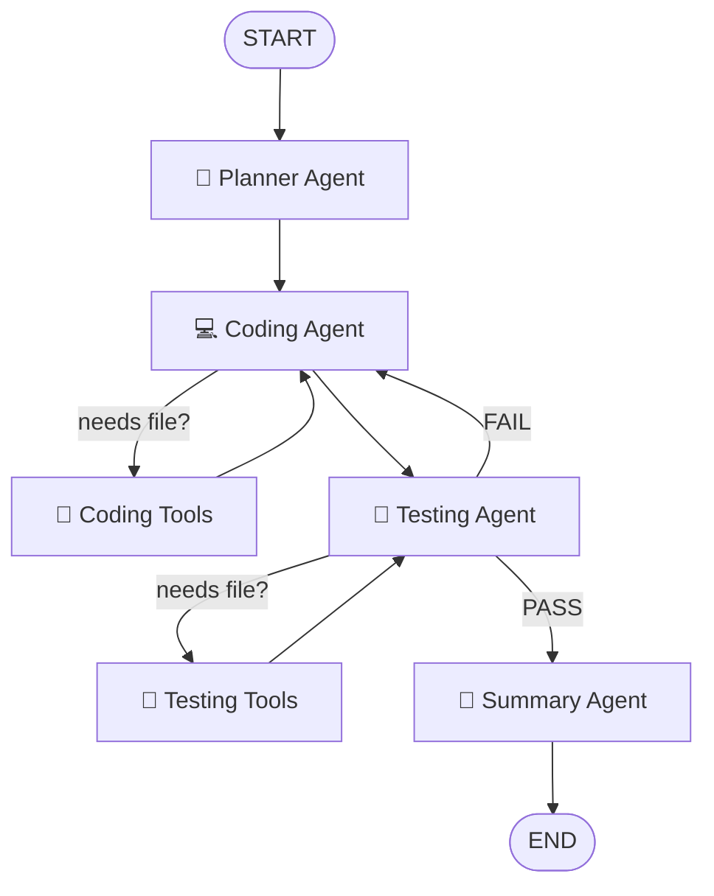
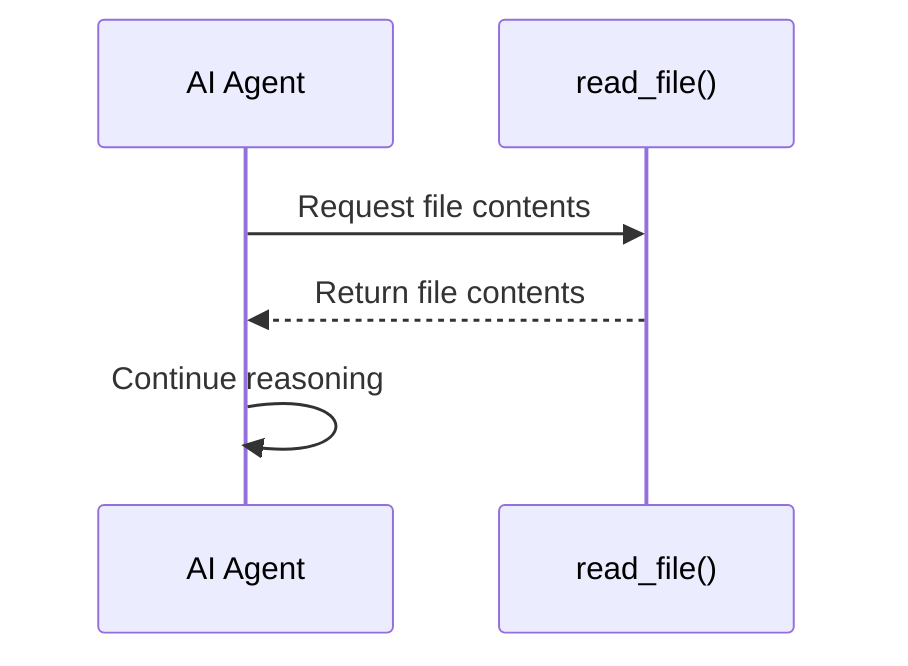

<div align="center">

# 🤖 Agentic Python Code Generator & Reviewer

### A multi-agent LangGraph workflow that plans, writes, reviews, and iteratively improves Python code — until it passes.


</div>

<br>

Instead of asking a single LLM to generate code in one shot, this project splits the job across **four specialized agents** — a planner, a coder, a tester, and a summarizer — that pass work back and forth through a LangGraph state machine until the code actually holds up.

| | |
|---|---|
| 🐍 **Language** | Python 3.11+ |
| 🧩 **Core Frameworks** | LangGraph, LangChain |
| 🔁 **Pattern** | Iterative plan → code → review → improve loop |
| 🎓 **Type** | Learning project (Agentic AI / Multi-Agent Systems) |

---

## 📖 Table of Contents

- [🔍 Overview](#-overview)
- [🎯 Motivation](#-motivation)
- [✨ Features](#-features)
- [🏗️ Architecture](#-architecture)
- [🧠 Agents](#-agents)
- [📦 State Management](#-state-management)
- [🔧 Tool Calling](#-tool-calling)
- [📚 Key Concepts Learned](#-key-concepts-learned)
- [📁 Output Files](#-output-files)
- [🛠️ Tech Stack](#-tech-stack)
- [🚀 Getting Started](#-getting-started)
- [🔮 Future Improvements](#-future-improvements)
- [✅ Challenges Solved](#-challenges-solved)
- [💡 Key Learnings](#-key-learnings)
- [👤 Author](#-author)

---

## 🔍 Overview

This project is an **Agentic AI workflow** built using **LangGraph** and **LangChain**. Instead of asking a single Large Language Model (LLM) to generate code, multiple specialized AI agents collaborate to solve the task.

The workflow follows an iterative software development lifecycle:

1. Understand the user's request
2. Create an implementation plan
3. Generate Python code
4. Review the generated code
5. If issues are found, improve the existing code
6. Repeat until the reviewer approves the implementation
7. Produce a final summary

The project demonstrates how multiple AI agents can work together using **graph-based execution** instead of a simple sequential pipeline.

---

## 🎯 Motivation

The purpose of this project was to understand:

- LangGraph
- Agentic AI
- Multi-Agent Systems
- State Management
- Tool Calling
- Conditional Graph Routing
- Iterative AI Workflows

Rather than simply generating code, the goal was to understand how modern AI agents communicate, share memory, make decisions, and improve their own work.

---

## ✨ Features

- Multi-agent workflow
- Planner agent
- Coding agent
- Testing agent
- Summary agent
- Tool calling
- Conditional routing
- Graph execution
- Persistent conversation state
- Automatic improvement loop

---

## 🏗️ Architecture

At a glance: **Planner → Coder ⇄ Tools → Tester ⇄ Tools → (FAIL loops back to Coder / PASS moves on) → Summary → End**



### Routing logic

The graph uses **conditional edges** to decide where to go next:

**Coding Agent router**
- Needs a tool? → `Coding Tools` → back to `Coding Agent`
- Otherwise → `Testing Agent`

**Testing Agent router**
- Needs a tool? → `Testing Tools` → back to `Testing Agent`
- `PASS` → `Summary Agent` → `END`
- `FAIL` → back to `Coding Agent` for another pass

---

## 🧠 Agents

| Agent | Role | Output |
|---|---|---|
| 🧭 **Planner** | Understands the request and breaks it into implementation steps | Detailed implementation plan |
| 💻 **Coding** | Generates Python code from the plan; revises it after reviewer feedback; reads existing files via tools when needed | `coder.py` |
| 🧪 **Testing** | Reviews the code — never rewrites it | `PASS` or `FAIL` |
| 📝 **Summary** | Summarizes the full workflow after successful completion | Final summary |

### 🧭 Planner Agent
**Responsibility**
- Understand the user's request
- Break the task into implementation steps
- Produce instructions for the coding agent

**Input:** User request
**Output:** Detailed implementation plan

### 💻 Coding Agent
**Responsibility**
- Read the planner's instructions
- Generate Python code
- Improve previous code after reviewer feedback
- Read existing code using tools if necessary

**Output:** `coder.py`

### 🧪 Testing Agent
Reviews the generated code for:
- Syntax errors
- Runtime errors
- Logic errors
- Edge cases
- Code quality
- Complexity

> **Note:** The reviewer never rewrites code — it only evaluates it.

It responds in one of two formats:

```
PASS
```

```
FAIL

Reason:
...

Required Changes:
...
```

### 📝 Summary Agent
After successful completion, summarizes the entire workflow.

---

## 📦 State Management

The graph uses a custom state that extends `MessagesState`:

```python
class AgentState(MessagesState):
    review_status: str
```

The current state carries two fields:

```
messages
review_status
```

The state travels through every node, and **each node updates only the fields it needs**. LangGraph automatically merges the returned values into the global state:

```json
{
    "messages": [response],
    "review_status": "PASS"
}
```

---

## 🔧 Tool Calling

Current tool:

```python
read_file(file_path)
```

This lets AI agents inspect generated files instead of relying on memory.



Execution is handled by a **`ToolNode`**, which runs the Python function the LLM requested and passes the result back into the conversation.

---

## 📚 Key Concepts Learned

| Concept | Description |
|---|---|
| **MessagesState** | Stores the growing conversation history: `UserMessage`, `AIMessage`, `ToolMessage`, `SystemMessage` |
| **AgentState** | Extends `MessagesState` with custom fields, e.g. `review_status`, `iteration`, `current_file` |
| **Nodes** | Each node performs one responsibility — `Planner`, `Coding`, `Testing`, `Summary` |
| **Edges** | The normal execution path between nodes, e.g. `Planner → Coding → Testing` |
| **Conditional Edges** | Routing decisions based on state, e.g. `PASS → Summary`, `FAIL → Coding` |
| **ToolNode** | Executes Python functions requested by the LLM (e.g. `read_file()`) and returns the result |

---

## 📁 Output Files

| File | Description |
|---|---|
| `coder.py` | Generated Python code |
| `testing.txt` | Final review or summary |

---

## 🛠️ Tech Stack

| Library | Role |
|---|---|
| **[LangGraph](https://github.com/langchain-ai/langgraph)** | Graph execution engine — manages nodes, edges, state, and routing |
| **[LangChain](https://github.com/langchain-ai/langchain)** | Provides chat models, message types, and tool integrations |
| **OpenRouter** | Provides access to language models |
| **python-dotenv** | Loads environment variables (e.g. `OPENROUTER_API_KEY`) |
| **uuid** | Generates unique thread IDs |
| **InMemorySaver** | Stores graph checkpoints to maintain conversation state |

---

## 🚀 Getting Started

### Prerequisites
- Python 3.11+

### Installation

```bash
pip install -r requirements.txt
```

`requirements.txt` should include:

```
langgraph
langchain
langchain-openai
python-dotenv
openai
pydantic
```

### Environment Variables

Create a `.env` file in the project root:

```env
OPENROUTER_API_KEY=your_api_key_here
```

---

## 🔮 Future Improvements

- [ ] Iteration counter to avoid infinite loops
- [ ] Multiple coding tools
- [ ] Python execution tool
- [ ] Auto syntax checker
- [ ] Unit test generation
- [ ] Linting using Ruff
- [ ] Static analysis using MyPy
- [ ] Git integration
- [ ] Docker support
- [ ] Retrieval-Augmented Generation (RAG)
- [ ] Memory across sessions
- [ ] Human approval node
- [ ] Multiple programming language support

---

## ✅ Challenges Solved

During development, several important LangGraph concepts were explored and understood:

- [x] Understanding `MessagesState`
- [x] Understanding custom graph state
- [x] Difference between state and messages
- [x] How node outputs are merged into state
- [x] Accessing AI responses from state
- [x] Tool calling lifecycle
- [x] `ToolNode`
- [x] `tools_condition`
- [x] Conditional routing
- [x] Graph visualization
- [x] Multi-agent communication
- [x] Looping workflows
- [x] Review-feedback-improvement cycle

---

## 💡 Key Learnings

This project demonstrates that an AI agent is more than a single LLM call. An effective agent consists of:

- Structured state
- Decision making
- Specialized agents
- Tool usage
- Memory
- Graph execution
- Iterative refinement

These concepts form the foundation of modern Agentic AI systems.

---

## 👤 Author

Developed as a learning project to deeply understand **LangGraph**, **Agentic AI**, **Multi-Agent Systems**, and iterative AI software engineering workflows.

<div align="center">

⭐ If this helped you understand LangGraph or agentic workflows, consider giving it a star!

</div>
